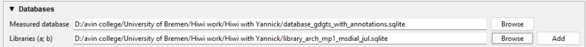
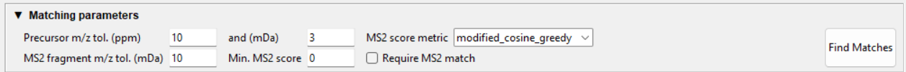
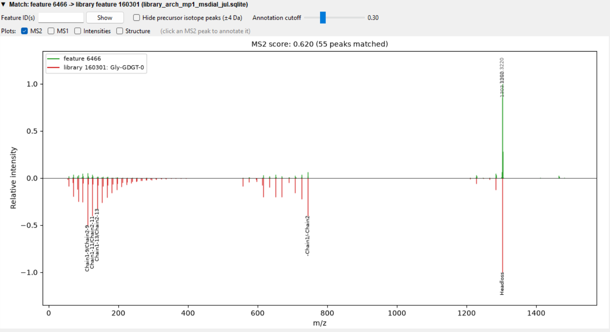
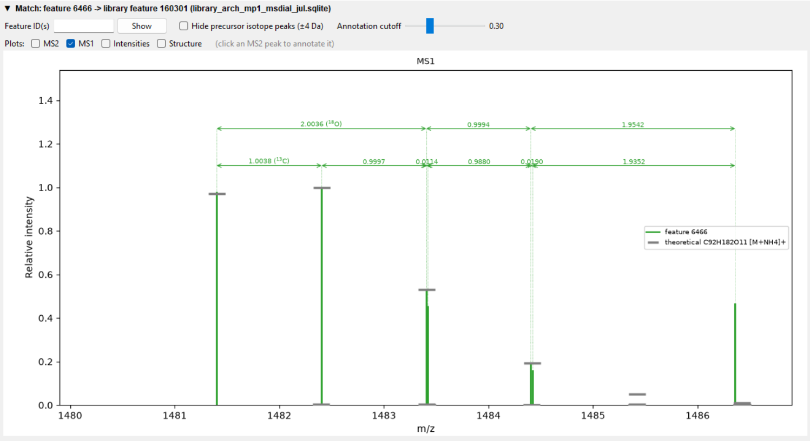
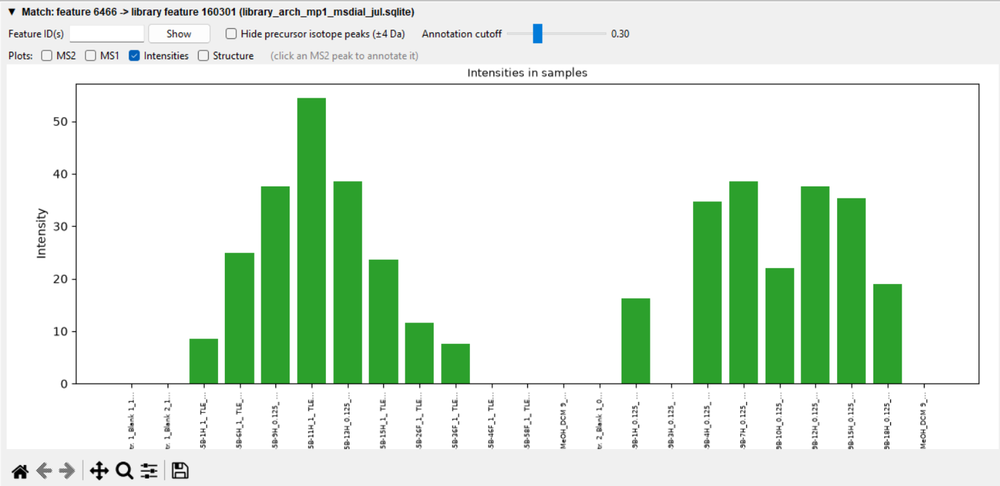
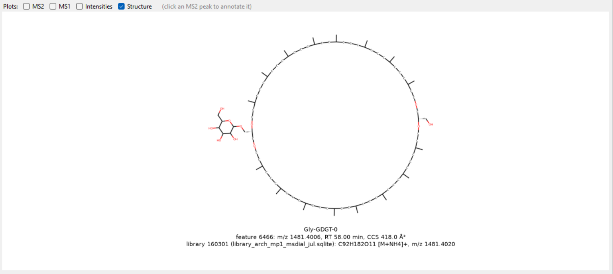
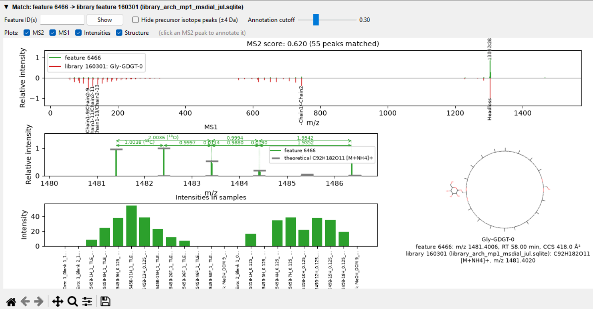

<h1 align="center">msIO Graphical User Interface</h1>

## 1. Overview

The msIO graphical user interface (GUI) provides a user-friendly environment for importing, exploring, comparing, and annotating mass spectrometry data.

The GUI supports the loading of measured feature databases and spectral libraries, matching measured features against reference spectra, visualising MS1 and MS2 spectra, and managing compound annotations.

This documentation introduces the main GUI components and demonstrates their functionality through screenshots and example results.

## 2. Main GUI Layout

The Annotation GUI is divided into several sections, each designed for a specific part of the analysis workflow.


<p align="center">
  Figure 1. Main interface of the msIO Annotation GUI.
</p>

The main sections are:

1. Databases: Used to load the measured feature database and reference spectral libraries.
2. Matching Parameters: Allows users to configure the parameters used for matching measured features against reference spectra.
3. Filters: Provides options to filter features and matching results based on different analytical parameters.
4. Results: Displays the potential matches and associated compound information.
5. Overview: Provides visualization of selected features, including MS1 and MS2 spectra, intensities, and molecular structures.
6. Scatter Plot: Allows users to explore feature distributions and investigate relationships between different features.

## 3. Loading Databases

Before performing spectral matching, users need to load the required databases.
The Databases section provides two input fields:

1. Measured database: Select the SQLite database containing the measured mass spectrometry features.
2. Libraries: Select a reference spectral library database. Additional libraries can be included using the Add button.



<p align="center">
  Figure 2. Database section of  msIO Annotation GUI.
</p>

**Note:** Both the measured database and at least one reference library must be loaded before beginning the matching process.

## 4. Matching Parameters

The Matching Parameters section allows users to define the criteria used to compare measured features with reference spectra.

The available parameters include:

<div align="center">

| Matching Parameter | Description |
| --- | --- |
| Precursor m/z tolerance (ppm) | Defines the maximum allowed mass deviation in ppm. |
| Precursor m/z tolerance (mDa) | Defines the maximum allowed absolute mass deviation in mDa. |
| MS2 fragment m/z tolerance (mDa) | Defines the allowed mass deviation for MS2 fragments in mDa. |
| Minimum MS2 score | Specifies the minimum spectral matching score required. |
| MS2 score metric | Selects the scoring metric used to evaluate spectral similarity. |
| Require MS2 match | Determines whether an MS2 spectral match is mandatory. |
</div>

After configuring the parameters, clicking Find Matches starts the matching process.



<p align="center">
        Figure 3. Matching parameter configuration.
</p>

After you click on the Finding Parameters, the GUI will display the matches in the 'Results' section.


<p align="center">
        Figure 4. Results section showing the matching paramters.
</p>


## 5. Filters

### 5.1 Available Filters

The Filters section allows users to narrow down the measured features and potential matching results using different analytical and compound-related criteria. Filters are applied while typing, allowing users to refine the displayed results without manually restarting the matching process.

<div align="center">

| Filter | Description |
|---|---|
| Meas. feature ID | Filters the results using the measured feature ID. |
| RT (min) | Filters features based on their retention time in minutes. |
| CCS (Ų) | Filters features according to their collision cross section values. |
| m/z | Filters features based on their mass-to-charge ratio. |
| Σ intensity | Filters features according to their summed signal intensity. |
| I1 / I0 | Filters features based on the I1/I0 intensity ratio. |
| Min. MS2 score | Displays matches with an MS2 score equal to or above the specified minimum. |
| Min. #MS2 peak matches | Filters matches according to the minimum number of matched MS2 fragment peaks. |
| \|Δm/z\| (mDa) | Filters matches based on the absolute precursor mass difference in millidaltons. |
| \|Δm/z\| (ppm) | Filters matches based on the relative precursor mass difference in parts per million. |
| ΔCCS (%) | Filters matches according to the percentage difference in collision cross section. |
| logP | Filters results based on the logP value. |
| Formula contains | Displays results whose molecular formula contains the specified text or element pattern. |
| Name contains (a; b) | Includes compound names containing the specified search terms. Multiple terms can be separated using a semicolon. |
| Name excludes (a; b) | Excludes compound names containing the specified search terms. |
| Library contains (a; b) | Restricts results to the specified spectral libraries. Multiple library names can be entered using semicolons. |
| Library excludes (a; b) | Excludes results originating from the specified spectral libraries. |
| Max. rows per feature | Limits the maximum number of result rows displayed for each measured feature. |
| Dummy row per feature | Controls the display of an additional dummy row for each feature. |

</div>


<p align="center">
        Figure 5. Available filters in the Filters section.
</p>

The user can add the filters according to the requirement and the user gets the output on the basis of the filters applied. An example of how the Filter section is shown in the Figure 6 where some of the available filter options (Min MS2 score, Min. #MS2 peak matches, etc.) are used to narrow down to the required compound list.


<p align="center">
        Figure 6. Results after applying the available filters.
</p>

The filters applied for the search can also be remove using **Remove Filters** option. 

### 5.1 Other Filter Options

The Filters section also provides several additional controls to manage how measured features and matching results are displayed.

| Option | Description |
|:---|:---|
| **Hide fragments, duplicates, isotope peaks and adducts** | Hides features that have been identified or marked as fragments, duplicates, isotope peaks or adducts. This helps focus the results on the remaining features. |
| **m/z from compound** | Opens a separate window where a compound can be searched and selected to obtain its corresponding m/z value. The calculated value can then be used as an m/z filter. The window also provides access to the intact polar lipid (IPL) builder and batch-generation options when the required LipidCalculator GUI components are available. |
| **Remove filters** | Clears the applied filter criteria, allowing the user to return to a less restricted view of the matching results. |

These options provide additional control over the presentation and interpretation of matching results, making it easier to focus on relevant measured features.

## 6. Results

The Results section displays the output (Figure 6) of the matching process between measured features and entries in the loaded databases. It presents the potential matches along with their associated analytical parameters, allowing users to evaluate and compare the candidate compounds.

The results table can be used to:
- View potential compound matches for individual measured features.
- Examine matching parameters such as precursor m/z differences, retention time, CCS and MS2 matching scores, where available.
- Compare multiple candidate matches associated with the same measured feature.
- Identify promising compound candidates based on their matching scores and other analytical parameters.
- Apply filters to narrow down the displayed results and focus on relevant matches.
- Inspect the results to support further compound annotation and interpretation.

The Results section serves as the main workspace for evaluating potential matches and identifying compounds that may correspond to the measured features.

## 7. Action Buttons

The row of buttons below the **Results** table acts on the feature currently selected in the table (highlighted in blue). The last action performed is reported in the status bar at the bottom of the window (e.g. Plotted match: feature 6466 -> library feature 160301 (...)).

| Button | Purpose |
|---|---|
| **Export annotations as library …** | Saves the current annotations as a new library database, so they can be reused in later sessions via the *Libraries* field. |
| **Mark fragment / duplicate / isotope / adduct …** | Flags the selected feature as an in-source fragment, duplicate, isotope peak or adduct of another feature. |
| **Add manual annotation** | Assigns a compound name, formula and adduct to the selected feature by hand, without a library match. |
| **Add library match** | Accepts the currently displayed library match for the selected feature as its annotation. |
| **Manage annotations** | Opens an overview of all annotations made so far, where they can be reviewed, edited or removed. |


<p align="center">
        Figure 7. Action buttons present below Results section.
</p>


### 7.1 Export annotations as library …

Opens a dialog to choose the output file name and location. The exported `.sqlite` file can be added as a library in the **Databases** section, so earlier annotations serve as reference for new measurements.

### 7.2 Mark fragment / duplicate / isotope / adduct …

Use this to flag features that are not independent compounds:

- **Fragment**: in-source fragment of a larger ion
- **Duplicate**: the same compound detected twice
- **Isotope peak**: e.g. the `[M+1]` signal of a monoisotopic feature (compare feature `6467`, `Gly-GDGT-0[M+1]`, in the table)
- **Adduct**: a different adduct of an already-annotated compound

Marked features can be hidden from the table with the filter **Hide features marked as fragment, duplicate, isotope peak or adduct**.

### 7.3 Add manual annotation

Use this when a feature is identified but has no suitable library match. Enter the compound name, formula and adduct for the selected feature. The annotation is then shown as *Annotated* (green dot) in the scatter plot.

### 7.4 Add library match

Select a row (a feature–library pair) and click this button to confirm the match. The row's compound name, formula and adduct become the feature's annotation. Check the MS2 mirror plot and MS2 score first (see below).

### 7.5 Manage annotations

Lists all annotations of the current session. Use it to correct mistakes, delete annotations, or check what will be exported.

---

## 8. Match Overview Panel (top right)

The title shows the current comparison:

```
Match: feature <measured ID> -> library feature <library ID> (<library file>)
```

Selecting a row in the **Results** table updates this panel automatically.

### 8.1 Controls

| Control | Description |
|---|---|
| **Feature ID(s)** | Enter one or more measured feature IDs and click **Show** to display them without selecting them in the table. |
| **Show** | Draws the plots for the feature ID(s) entered. |
| **Hide precursor isotope peaks (±4 Da)** | Removes peaks within ±4 Da of the precursor from the MS2 plot, so isotope signals do not clutter the spectrum. |

### 8.2 Plot selection

The checkboxes next to **Plots (Figure 8):** switch individual plots on or off:

| Checkbox | Plot |
|---|---|
| **MS2** | MS2 mirror plot |
| **MS1** | MS1 isotope pattern |
| **Intensities** | Intensities across samples |
| **Structure** | Structure of the library compound |


<p align="center">
        Figure 8. Matched overview plot features.
</p>

### 8.3 MS2 mirror plot

- **Top (green)**: measured MS2 spectrum of the selected feature
- **Bottom (red, mirrored)**: MS2 spectrum of the library compound
- The title shows the **MS2 score** and the number of matched peaks (e.g. `MS2 score: 0.620 (55 peaks matched)`)
- Peaks present in both spectra are matched within the **MS2 fragment m/z tolerance** set in *Matching parameters*
- Clicking a peak lets you attach an annotation (e.g. a fragment or chain label)



<p align="center">
        Figure 9. MS2 plot in the matched overview plot.
</p>

### 8.4 MS1 isotope pattern

Compares the measured MS1 isotope pattern of the feature (green) with the theoretical pattern (grey) of the library formula and adduct, e.g. `C92H182O11 [M+NH4]+`. A good overlap supports the formula assignment.



<p align="center">
        Figure 10. MS1 plot in the matched overview plot.
</p>

### 8.5 Intensities in samples

A bar chart of the feature's intensity in each sample, labelled on the x-axis. Use it to see in which samples (or sample groups) the compound occurs and to spot blanks or contamination.



<p align="center">
        Figure 11. Intensity plot in the matched overview plot.
</p>


### 8.6 Structure

Draws the chemical structure of the library compound. The caption lists the compound name and the feature's m/z, RT and CCS (e.g. `Gly-GDGT-0, feature 6466: m/z 1481.4006, RT 58.00 min, CCS 418.0 Ų`), plus the library feature ID.



<p align="center">
        Figure 12. Intensity plot in the matched overview plot.
</p>

### 8.7 All in One

The user can get one or more or all the above mentioned plots in the matched overview plot section together as well according to the requirements by selecting the checkboxes required (Figure 13).



<p align="center">
        Figure 14. Intensity plot in the matched overview plot.
</p>

### 8.8 Plot toolbar

Each plot area has the standard Matplotlib toolbar (at the bottom of Figure 14):

| Icon | Function |
|---|---|
| Home | Reset the view |
| Back / Forward | Step through previous views |
| Pan (cross arrows) | Drag to move the plot |
| Zoom (magnifier) | Drag a rectangle to zoom in |
| Configure subplots (sliders) | Adjust margins and spacing |
| Save (disk) | Save the plot as an image |

---

## 9. Scatter Plot Panel (bottom right)

The title is: **Scatter plot m/z vs RT**. It shows all measured features by retention time (x, min) and m/z (y).

The user can use the following steps:
- **Click**: selects the nearest feature in the Results table
- **Shift-click two features**: compares them (for example to check a mass difference)
- The cursor position is shown at the bottom right as `(x, y) = (RT, m/z)`

### 9.1 Display options

| Control | Description |
|---|---|
| **Show annotations** | Shows annotation labels next to annotated features. |
| **Circle matches** | Draws black circles around features that have a library match. |
| **Min. peak intensity** | Only features above this intensity are drawn (default `100`). Raise it to reduce clutter. |


<p align="center">
        Figure 15. Scatter plot.
</p>

### 9.2 Legend

| Symbol | Meaning |
|---|---|
| Green dot | **Annotated** feature |
| Black circle | **Library match** |
| Red circle | **Selected feature** |
| Blue dots | Features without annotation |

### 9.3 Searching for related features (series)

These fields highlight features that are related by a common fragment, neutral loss or mass difference, which helps to find compound families such as GDGTs with different numbers of rings.

| Field | Description |
|---|---|
| **Fragments (a; b)** | Highlights features whose MS2 spectra contain the given fragment ion(s). Several values are separated by `;`. A dropdown offers common choices. |
| **Losses (a; b)** | Highlights features whose MS2 spectra show the given neutral loss(es). |
| **Mass differences** | Finds features separated by a given mass difference. Accepts formulas and adduct exchange, for example `NH3`, `C[13] - C[12]`, or `[M+H]+>[M+NH4]+` (adduct exchange). Fragments are entered as ions, e.g. `C5H`. |
| **Series: extrapolate [n] members** | Number of further members the series is extended by beyond the features found (default `3`). |

### 9.4 Series buttons

| Button | Function |
|---|---|
| **Remove last series** | Deletes the most recently added series from the plot. |
| **Remove all series** | Clears all series from the plot. |

### 9.5 Plot toolbar

Same Matplotlib toolbar as above in the Matched Overview Plot (Home, Back/Forward, Pan, Zoom, Configure subplots, Save).
